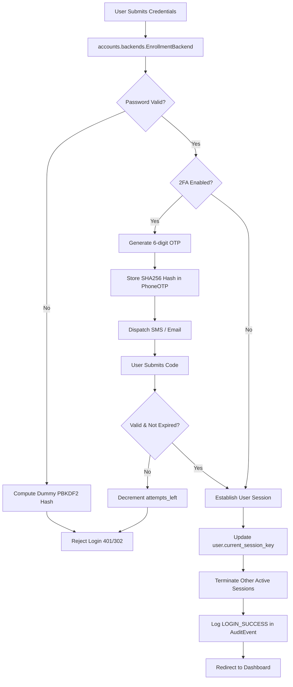
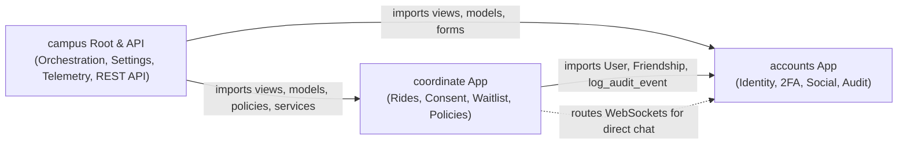

# Campus Nexus — Architecture & Codebase Map

> **Purpose:** This document provides an AI-readable, developer-ready architectural map of the **Campus Nexus** codebase (internal codename `COORDINATE`). It reflects the **actual current implementation** as of the latest hardened production release.

---

## 1. Project Overview

**Campus Nexus** is a centralized campus community and student coordination platform designed for the National Institute of Technology (NIT) Srinagar community. The platform unifies identity verification, student social connectivity, and shared campus logistics into a unified web application.

- **Flagship Subsystem:** **COORDINATE** — A verified peer-to-peer cab-sharing and travel coordination system for airport, railway, and local transit.
- **Service Modular Platform:** Includes a centralized Service Catalogue (`campus/services.py`) with active and upcoming micro-modules (e.g., Print Hub, Lost & Found, Mess Mate).
- **Core Technology Stack:**
  - **Language / Runtime:** Python 3.12 / 3.14
  - **Web Framework:** Django 6.0.5
  - **Asynchronous / WebSockets:** Django Channels 4.0, Daphne 4.0, channels-redis 4.2
  - **Frontend / Interactivity:** Django Server-Side Templates, django-htmx 1.27.0, Bootstrap 5 & Custom CSS/JS
  - **Authentication & Cryptography:** FIDO2 WebAuthn (`webauthn 2.0`), PBKDF2/Argon2 password hashing, SHA256 hashed OTPs
  - **Database:** PostgreSQL (production via `psycopg 3.1+`), SQLite3 (local development)
  - **Caching & Message Broker:** Redis 7 (production cache, rate-limiting, Channels layer, and presence leasing)
  - **Static & Media Asset Delivery:** WhiteNoise 6.6 (`CompressedManifestStaticFilesStorage`), Protected media handler (`serve_protected_media`)

---

## 2. Application Responsibilities

The codebase is organized into two primary domain applications (`accounts`, `coordinate`) and a root orchestration project application (`campus`):

```
Campus-Project/
├── accounts/          # Identity, authentication, 2FA, passkeys, social graph, audit trail
├── coordinate/        # Ride coordination, lifecycle state machine, consent, safety reviews
├── campus/            # Project root: settings, ASGI/WSGI, routing, REST API (v1), operations, telemetry
├── static/            # Static styles, JavaScript helpers (WebAuthn, HTMX, WebSocket clients)
├── templates/         # Django HTML templates organized by app domain
├── media/             # User-uploaded content (protected profile pictures)
└── manage.py          # Django management entry point
```

### 2.1. `accounts` Application
- **Custom User Model & Validation:** Manages student identity using the institutional `enrollment_number` as the primary login credential with auto-parsed fields (`joining_year`, `degree`, `branch`, `roll_number`).
- **Authentication & Credentials:** Case-insensitive custom authentication backend (`EnrollmentBackend`), password hashing with timing attack prevention.
- **Multi-Factor & Biometric Auth:**
  - Phone and Email OTP dispatch and verification (`accounts/two_factor.py`).
  - WebAuthn FIDO2 Biometric / Passkey credentials (`PasskeyCredential`).
  - Step-up re-authentication for security-sensitive profile and credential modifications.
- **Session Security:** Enforces strict single-session concurrency per account (`SingleSessionMiddleware`).
- **Student Onboarding:** Account application queue (`AccountApplication`) with administrative approval or in-person verification (`PhysicalVerificationRequest`).
- **Social Graph & Messaging:**
  - Friend requests (`FriendRequest`) and canonicalized bidirectional friendships (`Friendship`).
  - Real-time 1-on-1 direct messaging over WebSockets (`FriendChatConsumer`, `DirectMessage`) with presence lease management.
- **Operational Auditing & Feedback:** Append-only immutable audit trail (`AuditEvent`) and platform feedback/bug logging (`PlatformFeedback`).

### 2.2. `coordinate` Application
- **Ride Entity & Lifecycle Management:** CRUD, state management (`OPEN`, `FULL`, `COMPLETED`, `CANCELLED`), and route management for shared rides (`RideRequest`).
- **Audience Comfort & Privacy Controls:** Visibility tiers (`MIXED`, `BOYS`, `GIRLS`, `FRIENDS`) and kick/isolation lists.
- **Participation & Approvals:**
  - Explicit join requests requiring host review (`RideJoinRequest`).
  - Standby FIFO waitlist queue (`RideWaitlist`) with automatic promotion upon participant cancellation.
  - Passenger departure and host removal (`leave_ride`, `kick_participant`).
  - Atomic lifecycle operations via `coordinate/services.py`.
- **Affirmative Scoped Consent:** Centralized policy engine (`coordinate/policies.py`) governing explicit, revocable disclosure of identities and contact info (`RideConsent`).
- **In-Ride Group Communication:** Real-time multi-user WebSocket ride chat rooms (`RideChatConsumer`, `RideMessage`).
- **Peer Accountability & Safety:**
  - Post-ride peer reviews with punctuality, communication, and reliability scoring (`RideReview`).
  - Formal disciplinary incident reporting with chat transcript snapshots escalated to the Institute Proctorial Board (`RideIncidentReport`).

### 2.3. `campus` Project Root
- **Settings Hierarchy:** Split configuration for base settings, local development, and strict production verification (`campus/settings/`).
- **Protocol Routing:** HTTP/WS routing configuration (`campus/asgi.py`, `campus/wsgi.py`).
- **Central Service Catalogue:** System registry for campus micro-services (`campus/services.py`).
- **Versioned REST API (`/api/v1/`):** Token/bearer authenticated endpoints for mobile/third-party access (`campus/api/`).
- **Operations & Administration:** Superuser elevation/revocation, user record management, CSV data export with formula injection prevention (`campus/operations.py`).
- **Telemetry & Health Monitoring:** Thread-safe HTTP traffic metrics and system readiness check (`campus/telemetry.py`, `/health/`).

---

## 3. Important Models and Relationships

```mermaid
erDiagram
    User ||--o{ AccountApplication : creates
    User ||--o{ PasskeyCredential : owns
    User ||--o{ PhoneOTP : receives
    User ||--o{ PhysicalVerificationRequest : files
    User ||--o{ FriendRequest : "sends / receives"
    User ||--o{ Friendship : participates
    User ||--o{ DirectMessage : "sends / receives"
    User ||--o{ PlatformFeedback : submits
    User ||--o{ Contributor : nominated

    User ||--o{ RideRequest : "creates (host)"
    RideRequest ||--o{ RideParticipant : contains
    User ||--o{ RideParticipant : joins
    RideRequest ||--o{ RideJoinRequest : receives
    User ||--o{ RideJoinRequest : requests
    RideRequest ||--o{ RideWaitlist : queues
    User ||--o{ RideWaitlist : waits
    RideRequest ||--o{ RideConsent : governs
    User ||--o{ RideConsent : grants
    RideRequest ||--o{ RideMessage : contains
    User ||--o{ RideMessage : posts
    RideRequest ||--o{ RideReview : generates
    User ||--o{ RideReview : "reviews / reviewed"
    RideRequest ||--o{ RideIncidentReport : logs
    User ||--o{ RideIncidentReport : "reports / reported"
```



### 3.1. `accounts` Models (`accounts/models.py`)

| Model | Purpose | Key Fields | Relationships / Constraints |
| :--- | :--- | :--- | :--- |
| `User` | Custom user extending `AbstractUser`. | `enrollment_number` (unique, PK lookup), `phone_number`, `branch`, `degree`, `joining_year`, `gender`, `verified`, `is_deleted`, `current_session_key`, `rides_completed`, `on_time_count`. | Primary identity across all apps. `USERNAME_FIELD = 'enrollment_number'`. |
| `AccountApplication` | Queue for prospective student registrations. | `enrollment_number`, `full_name`, `email`, `phone_number`, `gender`, `password` (hashed), `application_number`, `phone_verified`, `approved`. | Created on public signup; converted to `User` upon staff approval. |
| `FriendRequest` | Social graph connection request. | `sender`, `receiver`, `created_at`. | FK to `User`. Unique constraint on `[sender, receiver]`. Check constraint preventing `sender == receiver`. |
| `Friendship` | Canonical undirected friendship edge. | `user1`, `user2`, `created_at`. | Canonical sort in `save()`: `user1_id < user2_id`. Unique constraint on `[user1, user2]`. |
| `DirectMessage` | 1-on-1 private chat message. | `sender`, `recipient`, `content`, `is_read`, `created_at`. | FKs to `User`. Ordered by `created_at`. |
| `PhoneOTP` | Cryptographic temporary verification token. | `user`, `purpose` (`2FA`, `SIGNUP`, `SECURITY_CHANGE`, `PASSWORD_RESET`), `otp_hash`, `phone_number`, `email`, `expires_at`, `attempts_left`, `is_used`. | Checked via `verify_phone_otp()`; invalidates after 3 failed attempts or 10 minutes. |
| `PasskeyCredential` | FIDO2 / WebAuthn biometric credential. | `user`, `credential_id`, `public_key`, `sign_count`, `name`, `last_used_at`. | Unique `credential_id`. Validated against RP origin & challenges. |
| `PhysicalVerificationRequest` | Offline institutional identity recovery. | `user`, `contact_email`, `contact_phone`, `status` (`PENDING`, `VERIFIED`, `REJECTED`), `verified_by`, `resolution_notes`. | FK to `User` (applicant and staff verifier). |
| `AuditEvent` | Tamper-evident, immutable event log. | `timestamp`, `event_type`, `actor_enrollment`, `description`, `target_id`. | Managed by `ImmutableAuditQuerySet`. Updates and deletions raise `PermissionError`. |
| `PlatformFeedback` | In-app feedback and bug report submissions. | `user`, `submitter_name`, `feedback_type`, `title`, `description`, `status`. | Nullable FK to `User` for anonymous reports. |
| `Contributor` | Student maintainers and developers. | `user`, `name`, `role`, `github_url`, `linkedin_url`, `nominated_by`, `is_active`. | Tracks community contributions and peer nominations. |

### 3.2. `coordinate` Models (`coordinate/models.py`)

| Model | Purpose | Key Fields | Relationships / Constraints |
| :--- | :--- | :--- | :--- |
| `RideRequest` | Master shared ride posting. | `creator`, `route`, `custom_from_location`, `custom_to_location`, `visibility` (`MIXED`, `BOYS`, `GIRLS`, `FRIENDS`), `departure_time`, `total_spots`, `status` (`OPEN`, `FULL`, `COMPLETED`, `CANCELLED`). | M2M `kicked_users`, M2M `left_users`. Auto-updates status on headcount change. |
| `RideParticipant` | Confirmed passenger membership. | `ride`, `user`, `joined_at`. | Unique constraint on `[ride, user]`. Validated against ride visibility rules in `clean()`. |
| `RideJoinRequest` | Formal host-moderated request to join. | `ride`, `user`, `status` (`PENDING`, `APPROVED`, `DECLINED`, `CANCELLED`), `note`, `reviewed_at`. | Unique constraint on `[ride, user]` for `PENDING` status. |
| `RideWaitlist` | Standby FIFO queue for full rides. | `ride`, `user`, `joined_at`. | Unique constraint on `[ride, user]`. Ordered by `joined_at` for strict FIFO promotion. |
| `RideReview` | Post-trip peer accountability rating. | `ride`, `reviewer`, `reviewed_user`, `rating`, `punctuality_rating`, `communication_rating`, `reliability_rating`, `grievance`, `complaint`. | Unique constraint on `[ride, reviewer, reviewed_user]`. Updates user reliability stats. |
| `RideMessage` | In-ride group chat transcript. | `ride`, `author`, `content`, `created_at`. | FKs to `RideRequest` and `User`. |
| `RideIncidentReport` | Formal disciplinary report. | `reference_id`, `ride`, `reporter`, `reported_user`, `category`, `statement`, `chat_transcript`, `escalated_to_institute`, `status`. | Unique `reference_id`. Snapshots in-ride chat transcript as forensic evidence. |
| `RideConsent` | Affirmative data disclosure agreement. | `ride`, `user`, `consent_version`, `disclose_ride_identity`, `share_contact_details`, `is_revoked`, `revoked_at`, `ip_address`. | Unique constraint on `[ride, user]`. Explicitly required to see participant phone numbers. |

---

## 4. URL and API Routing

### 4.1. Root & Marketing Routes (`campus/urls.py`, `campus/views.py`)
- `/` (`landing`): Public landing page with live platform statistics.
- `/about/` (`about_view`): Platform overview, mission, and architecture summary.
- `/contact/` (`contact_view`): Official institutional contact channels and administrative escalation info.
- `/contributors/` (`contributors_view`): Platform engineering team and contributor directory.
- `/contributors/nominate/` (`nominate_contributor`): Authenticated peer nomination endpoint.
- `/contributors/<id>/remove/` (`remove_contributor`): Staff-only contributor management.
- `/feedback/`, `/report-bug/` (`feedback_view`): Bug reports and user feedback form.
- `/services/` (`service_catalogue`): Directory of Campus Nexus services.
- `/services/<slug>/` (`service_gateway`): Gateway routing into specific micro-services (e.g., redirect to COORDINATE).
- `/health/` (`health_check`): Operational health monitoring check (verifies Database, Cache/Redis, and Telemetry).

### 4.2. Authentication & Credential Routes (`campus/urls.py`, `accounts/urls.py`)
- `/login/` (`custom_login_view`): Primary login view with single-session and 2FA intercept.
- `/login/2fa/` (`two_factor_verify`): SMS/Email OTP challenge verification.
- `/logout/` (`LogoutView`): Revokes session and clears user `current_session_key`.
- `/auth/passkey/authenticate/challenge/` (`passkey_auth_challenge`): WebAuthn login challenge generator.
- `/auth/passkey/authenticate/verify/` (`passkey_auth_verify`): WebAuthn assertion validation.
- `/auth/passkey/register/challenge/` (`passkey_reg_challenge`): WebAuthn registration challenge generator.
- `/auth/passkey/register/verify/` (`passkey_reg_verify`): WebAuthn credential registration.
- `/auth/passkey/<id>/delete/` (`passkey_delete`): Deletes registered passkey credential.
- `/auth/passkey/step-up/`, `/security/verify-step-up/` (`verify_security_step_up`): Re-authentication challenge for high-risk operations.
- `/password_change/` (`CustomPasswordChangeView`): Password change with immediate revocation of concurrent sessions.
- `/forgot-password/` (`forgot_password_view`): Multi-factor password reset and physical recovery filing.
- `/apply/` (`apply_account`), `/apply/success/` (`application_success`): Student registration workflow.

### 4.3. Accounts & Social Routes (`accounts/urls.py`)
- `/dashboard/` (`dashboard`): User homepage with active rides, friend updates, and statistics.
- `/profile/<enrollment>/` (`profile_view`): Student profile with field-level privacy gates.
- `/search/` (`user_search`): Student directory search (accessible only to verified accounts).
- `/messages/` (`messages_inbox`): Overview of active direct chats.
- `/messages/<enrollment>/` (`direct_chat_view`): 1-on-1 direct messaging interface.
- `/friends/<enrollment>/request/` (`send_friend_request`): Dispatch friend request.
- `/friends/<id>/accept/` (`accept_friend_request`): Accept friend request.
- `/friends/<id>/decline/` (`decline_friend_request`): Decline friend request.
- `/friends/<enrollment>/unfriend/` (`unfriend_user`): Remove friend connection.
- `/analytics/` (`admin_analytics`): Staff analytics dashboard.

### 4.4. Ride Coordination Routes (`coordinate/urls.py`)
- `/coordinate/`, `/coordinate/rides/` (`ride_list`): Filterable, searchable ride discovery feed.
- `/coordinate/my-rides/` (`my_rides`): Personal dashboard (hosted rides, joined rides, waitlist).
- `/coordinate/create/` (`create_ride`): Create new ride posting.
- `/coordinate/<id>/` (`ride_detail`): Detail view showing host, participants, chat room, and reviews.
- `/coordinate/<id>/join/` (`join_ride`): Submit join request and record affirmative consent.
- `/coordinate/<id>/requests/<req_id>/approve/` (`approve_join_request`): Host approves join request.
- `/coordinate/<id>/requests/<req_id>/decline/` (`decline_join_request`): Host declines join request.
- `/coordinate/<id>/requests/cancel/` (`cancel_join_request`): Passenger withdraws pending request.
- `/coordinate/<id>/leave/` (`leave_ride`): Passenger exits ride; triggers automatic waitlist promotion.
- `/coordinate/<id>/kick/<participant_id>/` (`kick_participant`): Host removes passenger.
- `/coordinate/<id>/waitlist/join/` (`join_waitlist`), `/leave/` (`leave_waitlist`): Standby queue operations.
- `/coordinate/<id>/reschedule/` (`reschedule_ride`): Host modifies departure time.
- `/coordinate/<id>/terminate/` (`terminate_ride`): Host cancels ride with participant notification.
- `/coordinate/<id>/complete/` (`complete_ride`): Host marks completed; unlocks peer review.
- `/coordinate/<id>/review/<user_id>/` (`review_user`): Peer review submission.
- `/coordinate/<id>/message/` (`send_message`): HTTP fallback message posting.
- `/coordinate/<id>/report-incident/` (`report_incident`): File disciplinary incident.

### 4.5. Operations & Administration (`campus/urls.py`, `campus/operations.py`)
- `/admin/`: Standard Django admin interface (hardened with platform 2FA and single-session checks).
- `/operations/` (`operational_dashboard`): Operational dashboard for server traffic, user approvals, and reports.
- `/operations/superusers/` (`manage_superusers`): Manage superuser status.
- `/operations/users/<id>/update-phone/` (`admin_update_phone`): Direct administrative phone correction.
- `/operations/users/<id>/delete/` (`admin_delete_account`): Soft-delete account and anonymize sessions.
- `/operations/physical-verification/<id>/resolve/` (`admin_resolve_physical_verification`): Staff resolution of in-person verification.
- `/operations/export/rides/` (`export_rides_csv`), `/users/` (`export_users_csv`), `/applications/` (`export_applications_csv`): Sanitized CSV data exports.

### 4.6. Versioned REST API v1 (`campus/api/urls.py`, `campus/api/views.py`)
- `GET /api/v1/`: API discovery root.
- `GET /api/v1/catalogue/`, `GET /api/v1/catalogue/<slug>/`: Service catalogue metadata.
- `POST /api/v1/auth/login/`: API authentication (returns session token).
- `POST /api/v1/auth/logout/`: API session invalidation.
- `GET /api/v1/me/`: Current authenticated user profile and stats.
- `GET /api/v1/rides/`: Filtered ride query feed.
- `POST /api/v1/rides/create/`: Create ride endpoint.
- `GET /api/v1/rides/<id>/`: Detailed ride representation.
- `POST /api/v1/rides/<id>/join/`: Request to join ride.
- `POST /api/v1/rides/<id>/requests/<id>/approve/`: Approve passenger.
- `POST /api/v1/rides/<id>/requests/<id>/decline/`: Decline passenger.
- `POST /api/v1/rides/<id>/leave/`: Leave ride.
- `GET /api/v1/my-rides/`: User's active and historical rides.

### 4.7. WebSocket Routing (`campus/asgi.py`, `coordinate/routing.py`)
- `ws/ride/<ride_id>/` (`RideChatConsumer`): In-ride group coordination chat.
- `ws/chat/direct/<friend_enrollment>/` (`FriendChatConsumer`): Private 1-on-1 direct chat with presence leasing.

### 4.8. Protected Media Routing (`campus/urls.py`)
- `re_path(r'^media/(?P<path>.*)$', serve_protected_media)`: Serves media files only after verifying that the requesting user has permission under `can_view_profile_field()`.

---

## 5. Authentication Architecture



### 5.1. Primary Authentication
- **Identifier:** `enrollment_number` (e.g. `2024BCSE001` or debug `20XXBCSE001`). Logins are strictly case-insensitive.
- **Backend:** `accounts.backends.EnrollmentBackend` validates credentials. If the user does not exist, a PBKDF2 hash operation is still performed to mitigate user enumeration through timing analysis.

### 5.2. Multi-Factor Authentication (2FA)
- **Token Generation:** `accounts.two_factor.create_phone_otp()` generates a 6-digit cryptographic numeric token.
- **Security Storage:** Plaintext OTPs are **never** stored in the database. Only their SHA256 digest (`otp_hash = hash_otp(code)`) is persisted in `PhoneOTP`.
- **Throttling & Expiry:** OTPs expire after 10 minutes and allow a maximum of 3 failed verification attempts before invalidation. Resend requests are throttled (60-second cooldown).

### 5.3. FIDO2 / WebAuthn Passkeys
- Implemented via `webauthn 2.0` in `accounts/two_factor.py` and `accounts/views.py`.
- **Registration:**
  1. `passkey_reg_challenge` generates a cryptographic challenge bound to the Relying Party ID (`WEBAUTHN_RP_ID`).
  2. The browser prompts Windows Hello, Touch ID, or security key.
  3. `passkey_reg_verify` verifies the attestation response and stores the public key and credential ID in `PasskeyCredential`.
- **Authentication:**
  1. `passkey_auth_challenge` issues an authentication challenge.
  2. `passkey_auth_verify` validates the cryptographic signature and updates `sign_count` (detecting credential cloning).

### 5.4. Single Active Concurrent Session Enforcement
- Implemented via `accounts.middleware.SingleSessionMiddleware`.
- Each user model record tracks `current_session_key`.
- On every incoming request, the middleware compares `request.session.session_key` against `user.current_session_key`.
- If an account is signed in from another browser or device, the earlier session is immediately invalidated, logged out, and redirected to `/login/` with an advisory message.
- `CustomPasswordChangeView` explicitly purges all active session keys from the database when a password is reset or modified.

### 5.5. Step-Up Re-Authentication
- Modifications to sensitive attributes (phone numbers, passkey deletion, password updates) require a fresh challenge via `verify_security_step_up` or an active session grace timestamp.

---

## 6. Inter-Application Dependencies



- **`accounts` is foundational:** It does not import from `coordinate` or `campus` (except for dynamic policy checks or lazy imports).
- **`coordinate` depends on `accounts`:** Uses `accounts.User` for host/passenger identity, `accounts.Friendship` for visibility comfort gating, and `accounts.models.log_audit_event` for operational history.
- **`campus` unifies all applications:**
  - Aggregates URLs from `accounts.urls` and `coordinate.urls`.
  - Exposes REST API endpoints in `campus.api` consuming models and services from both apps.
  - Controls file access in `serve_protected_media` using privacy functions from `coordinate.policies` and `accounts.models`.
  - Integrates operational reporting (`campus.operations`) by aggregating stats across `accounts.User` and `coordinate.RideRequest`.

---

## 7. Background Tasks, Services & Middleware

### 7.1. Django Channels & WebSocket Services
- **Channel Layer:** Configured in `campus/settings/base.py` and `campus/settings/prod.py`. Uses `channels_redis.core.RedisChannelLayer` in production with Redis 7; falls back to `InMemoryChannelLayer` in local development when Redis is omitted.
- **`RideChatConsumer` (`coordinate/consumers.py`):**
  - Group: `ride_<ride_id>`
  - Manages real-time in-ride chat rooms.
  - Automatically verifies participant status before accepting connections.
  - Sanitizes inbound frames and ignores non-text binary payloads.
- **`FriendChatConsumer` (`accounts/consumers.py`):**
  - Group: `direct_chat_<min_id>_<max_id>` (canonical pair ordering).
  - Handles 1-on-1 messaging between confirmed friends.
  - Tracks live typing indicators.
  - **Presence Leasing:** Manages real-time online status via Redis cache with a 120-second lease TTL and connection counter to guarantee that abrupt disconnects do not leave "ghost" online indicators.

### 7.2. Telemetry & Middleware Pipeline
The middleware pipeline in `campus/settings/base.py` executes in strict sequence:
1. `SecurityMiddleware`: HTTPS redirects, HSTS, secure headers.
2. `WhiteNoiseMiddleware`: Compressed static asset delivery.
3. `SessionMiddleware`: Session loading.
4. `CommonMiddleware`: URL normalization.
5. `CsrfViewMiddleware`: Cross-Site Request Forgery protection.
6. `AuthenticationMiddleware`: Associating user model to request.
7. `MessageMiddleware`: Flash message support.
8. `SingleSessionMiddleware`: Concurrent session termination.
9. `XFrameOptionsMiddleware`: Clickjacking protection (`DENY`).
10. `HtmxMiddleware`: Inspects HTMX headers (`request.htmx`).
11. `TrafficTelemetryMiddleware` (`campus/telemetry.py`): Passively measures latency, request throughput, peak requests per second (RPS), and interval metrics in a thread-safe Redis/in-memory cache.

### 7.3. Asynchronous File Cleanup Signals
- `cleanup_user_profile_photo_on_delete`: Signal in `accounts/models.py` ensuring orphaned image files are deleted from storage when a `User` is deleted.
- Automatic deletion of prior profile images on update via `transaction.on_commit()`.

---

## 8. Test Execution Instructions

The project features a test suite covering security controls, auth flows, ride concurrency, WebSockets, and administrative compliance.

### 8.1. Environment Setup
Always activate the workspace virtual environment before executing tests:
```powershell
# Windows PowerShell
.\venv\Scripts\activate
```

### 8.2. Django Test Runner
Run unit and integration tests using Django's test harness with the development settings:

```powershell
# Run the entire test suite (220+ tests)
python manage.py test campus.tests accounts coordinate --settings=campus.settings.dev

# Run core domain tests only
python manage.py test accounts coordinate --settings=campus.settings.dev

# Run campus platform and security test suites
python manage.py test campus.tests --settings=campus.settings.dev

# Run specific security or concurrency phases
python manage.py test campus.tests.test_phase1_security --settings=campus.settings.dev
python manage.py test campus.tests.test_stage5_lifecycle_concurrency --settings=campus.settings.dev
python manage.py test campus.tests.test_stage1_passkeys_cryptographic --settings=campus.settings.dev
```

### 8.3. Standalone Verification Crawlers
Two automated end-to-end audit scripts verify platform integrity against a running dev server or in-memory client:

```powershell
# 1. Full Platform Route & Security Crawler (49 verification checks)
python audit_platform.py

# 2. Full Platform State Machine & E2E Verification (64 verification checks)
python test_full_platform_e2e.py
```

### 8.4. Production Configuration Audit
To verify production settings and deployment posture:
```powershell
python manage.py check --deploy --settings=campus.settings.prod
```
*(Requires setting `DJANGO_SECRET_KEY`, `DATABASE_URL`, `REDIS_URL`, and `DJANGO_ALLOWED_HOSTS` in the environment).*

---

## 9. Important Architectural Conventions

### 9.1. Settings & Secrets Hygiene
- **Split Settings Architecture:** Settings are strictly modularized into `base.py`, `dev.py`, and `prod.py`.
- **Secrets Isolation:** Production (`campus/settings/prod.py`) explicitly forbids loading `secrets_local.py`. If `secrets_local` is imported in production, the application raises `ImproperlyConfigured` and halts startup.
- **Gitignored Files:** All local environment files (`.env`, `.env.*`, `campus/settings/secrets_local.py`, `*CREDENTIALS*.md`, `debug_accounts.md`) are ignored in `.gitignore` and `.dockerignore`.

### 9.2. Zero-Trust Privacy & Data Minimization
- **Affirmative Scoped Consent:** A student's phone number and email are **never** shared across rides by default. Phone numbers are revealed to co-passengers **only** when both parties have granted active, affirmative `RideConsent` for that specific ride, and only up to 2 hours post-departure (`coordinate/policies.py`).
- **Profile Photo Protection:** Profile photos uploaded to `/media/profiles/` are not publicly exposed as raw static files; requests are intercepted by `serve_protected_media` and authorized according to user privacy settings (`hide_profile_photo`, `hide_from_search`).
- **Student Directory Gating:** Anonymous or unverified visitors cannot query student listings; directory searches require `is_verified_student`.

### 9.3. Concurrency Safety & Atomic Services
- **Atomic Operations:** All critical state mutations (joining a ride, host approval, waitlist promotion, leaving, kicking) are isolated inside `coordinate/services.py` within `transaction.atomic()`.
- **Row-Level Locking:** High-contention transitions lock records using `select_for_update()` to prevent double-booking or overfilling beyond `total_spots`.

### 9.4. Tamper-Evident Operational Audit Log
- **Immutability:** The `AuditEvent` table is strictly append-only. Bulk updates (`update()`) and deletions (`delete()`) are intercepted by `ImmutableAuditQuerySet` and raise `PermissionError`. Individual model `delete()` and `save()` operations also prohibit modifications.
- **Privacy Preservation:** Audit records store minimal metadata (actor enrollment, event type, action timestamp) and never store raw passwords, tokens, or sensitive message contents.

### 9.5. Formula Injection & Output Sanitization
- All tabular data exports in `campus/operations.py` (`export_rides_csv`, `export_users_csv`, `export_applications_csv`) run every cell value through `sanitize_csv_cell()`. Any field beginning with spreadsheet formula triggers (`=`, `+`, `-`, `@`, `\t`, `\r`) is prepended with a single quote (`'`) to neutralize CSV injection attacks.
