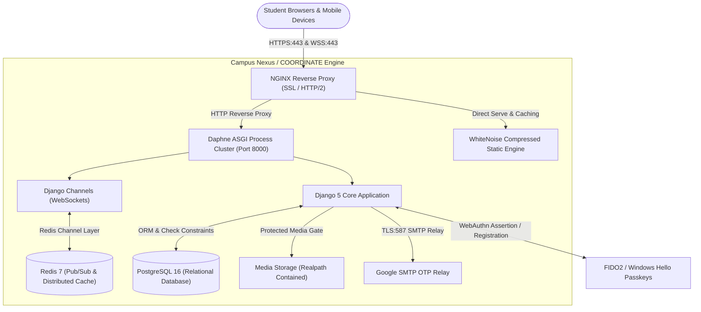

# COORDINATE // Campus Nexus

[](https://www.python.org/)
[](https://www.djangoproject.com/)
[](https://channels.readthedocs.io/)
[](https://www.postgresql.org/)
[](https://redis.io/)
[](https://webauthn.io/)
[-success.svg)](scripts/e2e/run_full_platform_e2e.py)
[](LICENSE)

> **Decentralized Student Ride Coordination & Verified Campus Public Utility Platform**  
> Designed, architected, and engineered for the student body of the **National Institute of Technology Srinagar (NIT Srinagar)**.  
> *Sic Itur Ad Astra* ("Thus one journeys to the stars")

---

## 📌 Executive Summary & Problem Statement

At university campuses, commuter students and hostel residents frequently need to coordinate shared cabs, airport shuttles, and inter-city travel (e.g. Srinagar &harr; Jammu / Airport / Railway Station). Traditionally, these requests were posted across dozens of cluttered, ephemeral WhatsApp groups where ride requests were quickly buried, timings were missed, and safety accountability was virtually non-existent.

**COORDINATE** solves this as a dedicated, real-time public digital utility:
1. **Physical Root of Trust:** Zero unverified internet trolls or duplicate accounts. Accounts are verified in person against physical institute student ID cards.
2. **Mutual Physical Accountability:** Anonymity is strictly prohibited inside moving vehicles. Confirmed co-passengers mutually share verified identities and pickup phone numbers.
3. **Real-Time Coordination:** ASGI WebSockets deliver instant ride chat, waitlist promotions, occupancy density curves, and departure synchronization.
4. **Institutional Security:** Cryptographic HMAC-SHA256 dual-channel OTPs, FIDO2/WebAuthn biometric passkeys, rate-limited reputation anti-farming, and single active session controls.

---

## 🏗️ Architecture & Technology Stack



### Core Technologies
* **Backend:** Python 3.12+, Django 5.0, Django Channels 4 (ASGI)
* **Application Server:** Daphne ASGI cluster
* **Database:** PostgreSQL 16 (with relational check constraints and select-for-update concurrency locks)
* **In-Memory Cache & Message Broker:** Redis 7 (`channels_redis` channel layer & distributed rate limiters)
* **Frontend:** Django Templates, HTMX, Vanilla ES6+ JavaScript, Bootstrap 5 Glassmorphism UI, Chart.js
* **Security & Auth:** WebAuthn / FIDO2 Passkeys (`fido2` library), HMAC-SHA256 OTP verification, Single Active Session Enforcement
* **Reverse Proxy:** NGINX with Let's Encrypt TLS & HTTP/2

---

## 🚀 Key Features & Engineering Highlights

### 1. In-Person Physical Root of Trust & Verification Desk
* Rather than relying solely on automated digital self-assertion, the platform anchors digital trust to physical reality.
* Students apply with their official enrollment number (`YYYY[BMP][BRANCH][ROLL]`) and phone number, verify inbox ownership via a 6-digit email OTP, and present their physical Institute ID card at the campus verification desk.
* Authorized student administrators review and approve accounts directly via the `/operations/` console.

### 2. Physical Ride Accountability & Audience Comfort
* **No Anonymous Riders IRL:** Inside a shared motor vehicle, passengers and host mutually view each other's verified student name, enrollment, and contact number with one-click call and WhatsApp integration.
* **Spectator Privacy:** Browsing students outside the ride see aggregate occupancy counts without access to passenger rosters or private phone numbers.
* **Audience Comfort Settings:** Ride hosts can specify comfort preferences: `MIXED`, `BOYS`, `GIRLS`, or `FRIENDS`-only.
* **Non-Destructive Soft Cancellation:** When all participants leave an active ride, the platform sets `status = 'CANCELLED'` rather than deleting database rows, permanently preserving safety incident reports, grievance histories, and audit evidence.

### 3. Anti-Farming Reliability Reputation Engine
* Every completed group commute increments a student's `rides_completed` counter.
* To prevent collusion and reputation score farming on a public utility, on-time reliability score boosts (`on_time_count`) are mathematically capped at **3 boosts per 15-day rolling window** per user.
* Enforced by database check constraint: `1 <= total_spots <= 6`.

### 4. FIDO2 / WebAuthn Biometric Passkeys
* Complete implementation of the WebAuthn standard allowing students to register and sign in with hardware security keys, Touch ID, Apple Face ID, or Windows Hello biometrics.
* Passkey registration and deletion require step-up re-authentication (< 5 min session freshness).

### 5. High-Privilege Governance & Anti-Lockout Invariant
* **Mandatory Staff 2FA:** All staff and superusers require multi-factor authentication on every login regardless of user-level toggles.
* **Hardened Admin:** Standard Django `UserAdmin` is locked down against backdoor privilege grants; superuser promotion and revocation are restricted to the audited `/operations/superusers/` endpoint.
* **Anti-Lockout Invariant:** The system cryptographically and programmatically prevents revoking or deleting the sole remaining active superuser.

---

## 🧪 Comprehensive Test Suite & Quality Assurance

Campus Nexus maintains a 100% green test suite across four distinct testing tiers:

```bash
# 1. Django Full Unit Test Suite (226 tests in 2.3 seconds)
python manage.py test campus.tests accounts coordinate --settings=campus.settings.test

# 2. Automated Platform Route Crawler (49 endpoints checked)
python scripts/e2e/run_platform_crawler.py

# 3. Deep Full-Platform E2E User Journey Verification (64 assertions)
python scripts/e2e/run_full_platform_e2e.py

# 4. Strict Release Packager & Artifact Hygiene Scanner
python scripts/package_release.py
```

### Verified Test Results:
* **Django Test Suite:** `226 passed, 0 failures, 0 errors` (Coverage: WebAuthn, Single-Session, Audience Filters, Concurrency Locks, Anti-Farming Capping, Protected Media Containment).
* **Platform Crawler:** `49 passed, 0 failed` across anonymous, authenticated, administrative, and REST API v1 routes.
* **Full E2E Verification:** `64 passed, 0 failed` across end-to-end user journeys (Application &rarr; OTP Verification &rarr; Admin Physical Desk Approval &rarr; Ride Creation &rarr; Waitlist &rarr; Ride Teardown).
* **Release Packager:** Zero secrets, zero bytecode, zero SQLite databases in git tracking (`0.35 MB` clean package).

---

## 📖 In-Depth Project Documentation

* **[MANIFESTO.md](MANIFESTO.md):** The Campus Nexus Manifesto, Design & Development Philosophy, and Data Governance/Access Control Charter.
* **[DEPLOYMENT.md](DEPLOYMENT.md):** Full production operations guide (Ubuntu 24.04, PostgreSQL 16, Redis 7, Systemd service unit, NGINX SSL/WSS, Certbot, automated backups, and zero-downtime updates).
* **[PROJECT_MAP.md](PROJECT_MAP.md):** Exhaustive architectural file-by-file specification and code reference.

---

## 💻 Local Development Quickstart

```bash
# 1. Clone repository
git clone https://github.com/Abdus-Samad-Saiyed/COORDINATE.git
cd COORDINATE

# 2. Create and activate virtual environment
python -m venv venv
# Linux / macOS:
source venv/bin/activate
# Windows:
.\venv\Scripts\activate

# 3. Install dependencies
pip install -r requirements.txt

# 4. Apply database migrations
python manage.py migrate --settings=campus.settings.dev

# 5. Run automated test suite
python manage.py test campus.tests accounts coordinate --settings=campus.settings.test

# 6. Start development server
python manage.py runserver --settings=campus.settings.dev
```

Access the development portal at `http://127.0.0.1:8000/`.

---

## 👤 Author & Architecture Lead

**Abdus Samad Saiyed**  
*Enrollment:* `2024BCSE065`  
*Department:* Computer Science & Engineering  
*Institution:* National Institute of Technology Srinagar (NIT Srinagar)  
*GitHub:* [@Abdus-Samad-Saiyed](https://github.com/Abdus-Samad-Saiyed)

---

*Sic Itur Ad Astra.*
