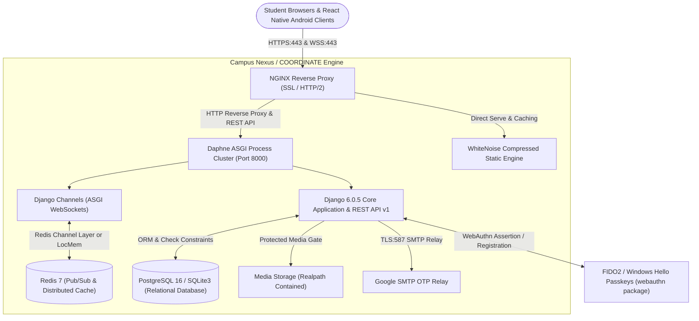

# COORDINATE // Campus Nexus

[](https://www.python.org/)
[](https://www.djangoproject.com/)
[](https://channels.readthedocs.io/)
[](https://www.postgresql.org/)
[](https://redis.io/)
[](https://webauthn.io/)
[](campus/api/)
[-success.svg)](scripts/e2e/run_full_platform_e2e.py)
[](LICENSE)

> **Decentralized Student Ride Coordination & Verified Campus Public Utility Platform**  
> Designed, architected, and engineered for the student body of the **National Institute of Technology Srinagar (NIT Srinagar)**.  
> *Sic Itur Ad Astra* ("Thus one journeys to the stars")

---

## 📌 Executive Summary & Problem Statement

At university campuses, commuter students and hostel residents frequently need to coordinate shared cabs, airport shuttles, and inter-city travel (e.g. Srinagar &harr; Jammu / Airport / Railway Station). Traditionally, these requests were posted across dozens of cluttered, ephemeral WhatsApp groups where ride requests were quickly buried, timings were missed, and safety accountability was virtually non-existent.

**COORDINATE** solves this as a dedicated, real-time public digital utility:
1. **Physical Root of Trust & Early Launch Agility:** Accounts are verified in person against physical student ID cards, with a built-in `--early-launch` toggle for instant self-declaration during high-demand end-of-term departure rushes.
2. **Mutual Physical Accountability:** Anonymity is strictly prohibited inside moving vehicles. Confirmed co-passengers mutually share verified identities and pickup phone numbers.
3. **Real-Time Coordination:** ASGI WebSockets deliver instant ride chat, waitlist promotions, occupancy density curves, and departure synchronization.
4. **Institutional Security:** Cryptographic HMAC-SHA256 dual-channel OTPs, FIDO2/WebAuthn biometric passkeys, rate-limited reputation anti-farming, and single active session controls.
5. **Multi-Client Ready:** Complete dual support for both Web (Django Templates + HTMX) and Mobile (React Native Android via Bearer Token REST & WebSocket APIs with full CORS support).

---

## 🏗️ Architecture & Technology Stack



### Core Technologies
* **Backend:** Python 3.12+, Django 6.0.5, Django Channels 4 (ASGI)
* **Application Server:** Daphne ASGI cluster
* **Database:** PostgreSQL 16 & SQLite3 (Dual production compatibility with WAL mode tuning)
* **In-Memory Cache & Message Broker:** Redis 7 (`channels_redis` channel layer & distributed rate limiters) with standalone LocMem fallback
* **Mobile / Frontend APIs:**
  * **Web Client:** Django Templates, HTMX, Vanilla ES6+ JavaScript, Bootstrap 5 Glassmorphism UI, Chart.js
  * **React Native Android Client:** Dedicated `/api/v1/` REST endpoints, Bearer session token authentication, profile photo multipart upload, `django-cors-headers`, and `TokenOrSessionAuthMiddleware` ASGI WebSockets
* **Security & Auth:** WebAuthn / FIDO2 Passkeys (`webauthn` library), HMAC-SHA256 OTP verification, Single Active Session Enforcement
* **Reverse Proxy:** NGINX with Let's Encrypt TLS & HTTP/2

---

## 🚀 Key Features & Engineering Highlights

### 1. In-Person Physical Root of Trust & Verification Desk
* Rather than relying solely on automated digital self-assertion, the platform anchors digital trust to physical reality.
* Students apply with their official enrollment number (`YYYY[BMP][BRANCH][ROLL]`) and phone number, verify inbox ownership via a 6-digit email OTP, and present their physical Institute ID card at the campus verification desk.
* Authorized student administrators review and approve accounts directly via the `/operations/` console.

### 2. Early Launch Mode (`--early-launch`) & Temporary Database Isolation
* During end-of-term transit surges when in-person desk verification creates an onboarding bottleneck, the system can be started with the `--early-launch` CLI flag or `EARLY_LAUNCH_MODE=True`.
* **Isolated Temporary Database:** All early access self-declarations, rides, and chats are written to `temp_early_access.sqlite3`. The permanent database is never touched, completely eliminating data corruption or conflicts with real accounts.
* **Untrusted Status (`verified=False`):** Self-declared accounts are explicitly marked untrusted, badged in profiles and rosters, and temporary.
* **Purgeable & Reversible:** Omitting `--early-launch` restores the pristine permanent database. Run `python manage.py purge_early_launch` to purge the temporary database post-rush.

### 3. Dynamic Ride Capacity Modification & Surplus Ejection
* Hosts can adjust total vehicle capacity post-creation (`1 <= total_spots <= 6`).
* When decreasing capacity below current passenger count, hosts must explicitly select which surplus passenger(s) to remove, preventing arbitrary or unhandled drops while automatically recalibrating waitlists.

### 4. Theme-Synchronized Canvas Favicon Engine
* Tab favicons dynamically re-render on an HTML5 `<canvas>` in real-time, matching the active user colorway (Emerald, Cyan, Indigo, Amber, Rose, etc.) or custom hex values.
* Fallback 32x32 PNG endpoint served at `/favicon.ico` with HTTP 200 OK.

### 5. Interactive Database Setup & Management Script
* Built-in interactive setup utility: `python setup.py` (or `python manage.py setup_db`).
* Interactive migration runner that prompts before applying schema updates.
* Full menu-driven database inspector: browse tables, execute DQL (`SELECT`), execute transactional DML/DDL (`INSERT`/`UPDATE`/`DELETE`), and view real-time diagnostics.
* Abstracted User Provisioning: create Superuser Admins, Staff, or Standard Students directly in PostgreSQL or SQLite with automatic enrollment parsing and password hashing.

### 6. Physical Ride Accountability & Audience Comfort
* **No Anonymous Riders IRL:** Inside a shared motor vehicle, passengers and host mutually view each other's verified student name, enrollment, and contact number with one-click call and WhatsApp integration.
* **Spectator Privacy:** Browsing students outside the ride see aggregate occupancy counts without access to passenger rosters or private phone numbers.
* **Audience Comfort Settings:** Ride hosts can specify comfort preferences: `MIXED`, `BOYS`, `GIRLS`, or `FRIENDS`-only.
* **Non-Destructive Soft Cancellation:** When all participants leave an active ride, the platform sets `status = 'CANCELLED'` rather than deleting database rows, permanently preserving safety incident reports, grievance histories, and audit evidence.

### 7. Anti-Farming Reliability Reputation Engine
* Every completed group commute increments a student's `rides_completed` counter.
* To prevent collusion and reputation score farming on a public utility, on-time reliability score boosts (`on_time_count`) are mathematically capped at **3 boosts per 15-day rolling window** per user.
* Enforced by database check constraint: `1 <= total_spots <= 6`.

### 8. FIDO2 / WebAuthn Biometric Passkeys & Mobile Token Parity
* WebAuthn standard implementation allowing students to register and sign in with hardware security keys, Touch ID, Apple Face ID, or Windows Hello biometrics.
* React Native Android clients authenticate using Bearer session tokens with full WebSocket parity.

---

## 🧪 Comprehensive Test Suite & Quality Assurance

Campus Nexus maintains a 100% green test suite across four distinct testing tiers:

```bash
# 1. Django Full Unit & Integration Test Suite (268 tests in ~3.5 seconds)
python manage.py test campus.tests accounts coordinate --settings=campus.settings.test

# 2. Automated Platform Route Crawler (49 endpoints checked)
python scripts/e2e/run_platform_crawler.py

# 3. Deep Full-Platform E2E User Journey Verification (64 assertions)
python scripts/e2e/run_full_platform_e2e.py

# 4. Strict Release Packager & Artifact Hygiene Scanner
python scripts/package_release.py
```

### Verified Test Results:
* **Django Test Suite:** `268 passed, 0 failures, 0 errors` (Coverage: Early Launch Mode, Dynamic Capacity Modification, WebAuthn, Single-Session, Audience Filters, Concurrency Locks, Anti-Farming Capping, Protected Media Containment, Setup DB, React Native Mobile API, Dual Production DB).
* **Platform Crawler:** `49 passed, 0 failed` across anonymous, authenticated, administrative, and REST API v1 routes.
* **Full E2E Verification:** `64 passed, 0 failed` across end-to-end user journeys (Application &rarr; OTP Verification &rarr; Admin Physical Desk Approval &rarr; Ride Creation &rarr; Waitlist &rarr; Ride Teardown).
* **Release Packager:** Zero secrets, zero bytecode, zero SQLite databases in git tracking (`0.37 MB` clean package).

---

## 📖 In-Depth Project Documentation

* **[ARCHITECTURE.md](docs/ARCHITECTURE.md):** Complete architectural topologies, service registries, WebSockets protocol routers, and performance optimizations.
* **[AUTHENTICATION_AND_SECURITY.md](docs/AUTHENTICATION_AND_SECURITY.md):** Identity models, dual-channel OTPs, WebAuthn passkeys, single-session concurrency, and Early Launch security.
* **[OPERATIONS_AND_ADMINISTRATION.md](docs/OPERATIONS_AND_ADMINISTRATION.md):** Administrator console, physical verification desk manual, CSV exports, and Early Launch operations.
* **[MECHANICAL_ZEN_AND_THEMES.md](docs/MECHANICAL_ZEN_AND_THEMES.md):** Clockwork watermark engine, Zen mode mechanics, theme accent system, and dynamic canvas favicons.
* **[DEPLOYMENT_AND_PRODUCTION.md](docs/DEPLOYMENT_AND_PRODUCTION.md):** NGINX, Daphne, SSL, and systemd deployment manuals.

---

## 💻 Local Development Quickstart

```bash
# 1. Clone repository
git clone https://github.com/Abdus-Samad-Saiyed/Campus-Nexus.git
cd Campus-Nexus

# 2. Create and activate virtual environment
python -m venv venv
# Linux / macOS:
source venv/bin/activate
# Windows:
.\venv\Scripts\activate

# 3. Install dependencies
pip install -r requirements.txt

# 4. Configure environment
cp .env.example .env

# 5. Interactive Database Setup & User Provisioning
python setup.py
# (Or apply migrations directly: python manage.py migrate --settings=campus.settings.dev)

# 6. Run automated test suite
python manage.py test campus.tests accounts coordinate --settings=campus.settings.test

# 7. Start development server
# Standard Mode (with Physical Verification Desk):
python manage.py runserver 0.0.0.0:8000 --settings=campus.settings.dev

# Or Early Launch Mode (Instant Self-Declaration for Transit Rush):
python manage.py runserver --early-launch 0.0.0.0:8000 --settings=campus.settings.dev
```

Access the development portal at `http://127.0.0.1:8000/`.

---

## 👤 Author & Architecture Lead

**Abdus Samad Saiyed**  
*Enrollment:* `2024BCSE065`  
*Department:* Computer Science & Engineering  
*Institution:* National Institute of Technology Srinagar (NIT Srinagar)  
*GitHub:* [@Abdus-Samad-Saiyed](https://github.com/Abdus-Samad-Saiyed)  
*LinkedIn:* [abdussamadsaiyed](https://www.linkedin.com/in/abdussamadsaiyed)  

---

*Sic Itur Ad Astra.*
