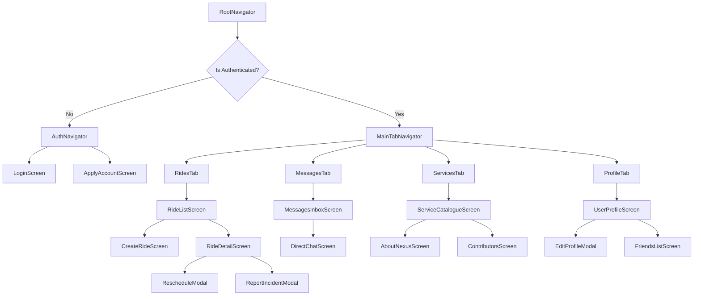

# Campus Nexus — Android Mobile Architecture Plan (React Native + Expo)

## Executive Summary
This document outlines the complete architectural design and implementation plan for the **Campus Nexus Android Application**, built with **React Native (Expo SDK 51+) and TypeScript**. The mobile app brings all Campus Nexus digital services—including cab coordination (**COORDINATE**), real-time WebSocket ride chat, standby waitlists, 1-on-1 direct friend messaging, incident proctorial escalation, and student profiles—to Android devices with zero compromise on security, performance, or battery efficiency.

In accordance with institutional guidelines:
- **Zero Payment / Zero Fare Splitting:** The mobile client strictly excludes all financial handling, payments, UPI integrations, and fare disputes. It functions solely as a verified student ride-coordination platform.
- **Standby Waitlist Management:** Full rides support a standby queue with real-time push notifications upon seat promotion.
- **Lifecycle Teardowns:** Dynamic socket termination and instant UI lockdown when rides conclude.
- **Strict Gender Segregation:** Girls-Only and Boys-Only ride creation and participation validated across UI, API, and model layers.

---

## 1. Technical Stack & Dependencies

| Layer | Library / Tool | Rationale |
| :--- | :--- | :--- |
| **Framework** | Expo SDK 51+ (React Native 0.74+) | Accelerated cross-platform compilation, Hermes engine, fast OTA updates. |
| **Language** | TypeScript 5.4+ (Strict Mode) | Full compile-time type safety across API schemas, WebSocket frames, and navigation routes. |
| **Navigation** | `@react-navigation/native-stack` + `@react-navigation/bottom-tabs` | 60 FPS native transition performance, gesture handlers, Android back-button compliance. |
| **State & Store** | `Zustand` + `immer` | Ultra-lightweight reactive global state without Redux boilerplate. |
| **Server Cache** | `@tanstack/react-query` (v5) | Automatic background refetching, mutation rollbacks, query invalidation, and offline caching. |
| **HTTP Client** | `axios` with interceptors | Automated token refresh, enrollment request headers, and custom network timeout handling. |
| **Secure Storage** | `expo-secure-store` | Hardware-backed keystore encryption for user tokens and authentication credentials. |
| **Real-Time WS** | Custom `ReconnectingWebSocket` class | Exponential backoff reconnection, heartbeat ping/pong, and background app state resilience. |
| **Notifications** | `expo-notifications` | Push notification delivery for standby promotions, friend requests, and urgent ride updates. |
| **Styling** | `react-native-paper` + `twrnc` (Tailwind) | Dark/Light mode theme tokens mirroring the Campus Nexus design language (`#08B74F` neon green accent, glassmorphic cards). |

---

## 2. Directory Structure

```
campus-nexus-mobile/
├── app.json
├── babel.config.js
├── tsconfig.json
├── package.json
└── src/
    ├── api/
    │   ├── client.ts             # Axios instance with auth interceptor
    │   ├── authApi.ts            # Login, apply, session refresh
    │   ├── ridesApi.ts           # Fetch rides, join, waitlist, reschedule, incident reports
    │   └── friendsApi.ts         # Friend lists, requests, direct messages history
    ├── socket/
    │   ├── WebSocketManager.ts   # Core robust WS connection orchestrator
    │   ├── useRideSocket.ts      # Hook for in-ride group chat
    │   └── useFriendSocket.ts    # Hook for 1-on-1 DM chat, typing & presence
    ├── navigation/
    │   ├── RootNavigator.tsx     # Conditional rendering based on auth state
    │   ├── AuthNavigator.tsx     # Login, Apply account stack
    │   └── MainTabNavigator.tsx  # Bottom tab bar (Rides, Messages, Services, Profile)
    ├── screens/
    │   ├── auth/
    │   │   ├── LoginScreen.tsx
    │   │   └── ApplyAccountScreen.tsx
    │   ├── rides/
    │   │   ├── RideListScreen.tsx       # Date-time range filtering & quick date buttons
    │   │   ├── RideDetailScreen.tsx     # Live room, passengers, standby queue, WS chat
    │   │   ├── CreateRideScreen.tsx     # Route, spots, gender visibility checks
    │   │   └── ReportIncidentModal.tsx  # Evidence snapshot & proctorial escalation
    │   ├── messages/
    │   │   ├── MessagesInboxScreen.tsx  # List of friend threads with unread badges
    │   │   └── DirectChatScreen.tsx     # 1-on-1 friend chat with typing indicator & presence
    │   ├── profile/
    │   │   ├── UserProfileScreen.tsx    # Identification data, photo, friend toggle
    │   │   └── EditProfileModal.tsx     # Image upload via expo-image-picker
    │   └── nexus/
    │       ├── ServiceCatalogueScreen.tsx
    │       ├── AboutNexusScreen.tsx
    │       └── ContributorsScreen.tsx
    ├── components/
    │   ├── common/
    │   │   ├── GlassCard.tsx            # Styled glassmorphic container
    │   │   ├── StatusBadge.tsx          # Open/Full/Standby/Visibility badges
    │   │   └── ThemeSwitcherButton.tsx  # Dark/Light toggle
    │   └── watermark/
    │       └── ClockworkWatermark.tsx   # React Native SVG center clock + edge gears
    ├── store/
    │   ├── useAuthStore.ts       # User enrollment, session token, gender, permissions
    │   └── useThemeStore.ts      # Persistent theme state
    └── types/
        ├── navigation.ts
        ├── ride.ts
        └── chat.ts
```

---

## 3. Screen Hierarchy & Navigation Architecture



---

## 4. Feature Implementations & Technical Contracts

### 4.1. Ride Browsing, Date-Time Range & Capacity
- **Date Strip:** Horizontally scrollable 7-day calendar strip matching backend dynamic date centering.
- **Range Picker:** Native date and time dialogs allowing users to filter rides across customizable time windows.
- **Capacity Indicator:** Animated progress bar displaying occupied spots (`p.count / total_spots`).
- **Standby UX:**
  - If ride is `OPEN` and user is eligible: primary `Join Ride` button.
  - If ride is `FULL` and user is eligible: warning-styled `Join Standby` button.
  - If user is already on waitlist: displays `Standby Position #X` with button to `Leave Standby`.

### 4.2. In-Ride Chat & WebSocket Lifecycle
- Connects to `wss://campus-nexus.institute/ws/ride/{ride_id}/`.
- Sends typed JSON frames: `{"content": "..."}`.
- Listens for server lifecycle events:
  - `chat.message`: Appends bubble to chat list with delivery tick.
  - `system_notice (rescheduled)`: Updates departure banner and displays system notification badge.
  - `system_notice (waitlist_promoted)`: Updates passenger list dynamically.
  - `system_notice (completed | cancelled | terminated)`: Displays session termination banner, locks chat input, and severs WebSocket connection with code 4001.

### 4.3. 1-on-1 Direct Friend Messaging
- Connects to `wss://campus-nexus.institute/ws/chat/direct/{friend_enrollment}/`.
- **Typing Status:** Throttled typing broadcast (`{"type": "typing", "is_typing": true}`) on `onChangeText`; cancels after 1.5 seconds of inactivity.
- **Presence Indicator:** Listens for `chat.presence` packets, updating the friend's avatar badge to live green dot (`Active now`).
- **Offline Fallback:** If socket connection drops, messages fallback smoothly to standard REST POST `/messages/{enrollment}/` with optimistic UI insertion.

### 4.4. Student Profile & Identification Data
- Displays full verified identification:
  - Degree, Department, Joining Year, Roll Number, On-time Reliability Rate, Rides Completed, Incident Flag status.
- **Privacy Enforcement:** Phone number hidden unless co-passenger or confirmed friend.
- **Profile Photo Upload:** Native image picking with compression (`expo-image-manipulator`) before multipart upload to `/profile/{enrollment}/`.
- **Public Friends Toggle:** User can switch `show_friends_publicly` on/off directly from mobile settings modal.

---

## 5. Security & Network Fault Tolerance

1. **Hardware-Backed Keystore:**
   Authentication credentials are encrypted using AES-256 via `expo-secure-store`.
2. **App State Awareness:**
   When the Android app moves to the background (`AppState.addEventListener('change', ...)`), active WebSocket connections pause non-essential frames, and push notification tokens are registered to ensure background delivery without battery drain.
3. **Optimistic UI Updates:**
   Messages are rendered immediately in state with a pending clock icon, replaced with a double-check icon once the server returns `{type: 'ack', status: 'sent'}`.
4. **Offline Resiliency:**
   TanStack Query caches ride listings in SQLite (`expo-sqlite` / MMKV persistence) so students with spotty campus Wi-Fi can view their booked rides offline.

---

## 6. Implementation Milestones

- **Phase A (Foundation):** Expo scaffolding, theme tokens, SecureStore auth client, Login/Apply screens.
- **Phase B (Coordinate Core):** Ride listing, custom date-time range filters, Create Ride screen with gender validation, Ride Detail passenger list.
- **Phase C (Real-Time Websockets):** In-ride group chat, rate limiting, and lifecycle teardown handling.
- **Phase D (Standby & Rescheduling):** Standby queue join/leave, automatic promotion UX, host rescheduling modal.
- **Phase E (Social & Friends DM):** 1-on-1 direct messaging, typing indicator, live presence indicator, profile photo uploads.
- **Phase F (Build & Release):** Android APK build via EAS Build (`eas build -p android --profile preview`), end-to-end integration testing.
